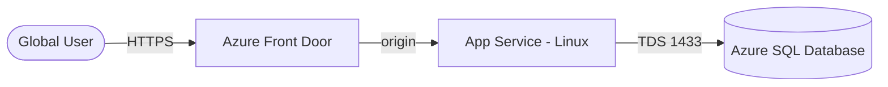

# Azure Web App + SQL + Front Door (Terraform)

> A web app on Azure App Service, backed by Azure SQL, published globally through Azure Front Door — provisioned with Terraform.
> **Author:** Muhammad Ahmad · **IaC:** Terraform · **Cloud:** Azure


---

## 📌 Overview

- **App Service (Linux)** runs the web application on a dedicated plan.
- **Azure SQL** provides the managed relational database (TLS 1.2 enforced).
- **Azure Front Door (Standard)** gives a global, HTTPS-only entry point with health probes and caching in front of the app.

## 🏗️ Architecture

> 🎨 **Interactive diagram (industry-standard icons):** [open in Lucid — page 13](https://lucid.app/lucidchart/3da75ce3-ea66-4296-81b3-00d20a60435b/edit)



## 🚀 Deploy

```bash
cd terraform
az login
export TF_VAR_sql_admin_password='YourStr0ng!Passw0rd'
terraform init
terraform apply

terraform output frontdoor_endpoint
```

## 🧹 Clean up

```bash
terraform destroy
```

## 💰 Cost note

App Service (B1), Azure SQL (Basic), and Front Door Standard all bill while running. Destroy when done.

## 🔐 Production hardening (next steps)

- Store the DB password in **Key Vault** and reference it from App Service.
- Lock SQL to **Private Endpoint** instead of the Azure-services firewall rule.
- Add a **WAF policy** on Front Door.

---

*Built and maintained by **Muhammad Ahmad**.*
