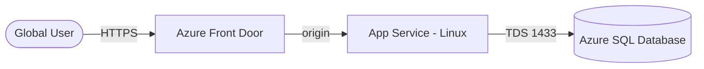

# Architecture Diagram — Azure Web App + SQL + Front Door

## Lucid diagram

- **Master Lucid document (all 30 diagrams, icon style):** https://lucid.app/lucidchart/3da75ce3-ea66-4296-81b3-00d20a60435b/edit
- This project is **page 13** of that document.

## Lucid prompt (reusable)

```
Create an Azure architecture diagram titled "Azure Web App + SQL + Front Door".
A Global User connects over HTTPS to Azure Front Door, which forwards to an App
Service (Linux) origin; the App Service connects to an Azure SQL Database over TDS
(port 1433). Label the arrows. Clean, professional Azure colors.
```

## Mermaid source


